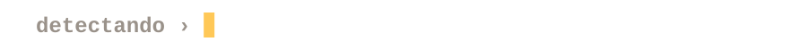
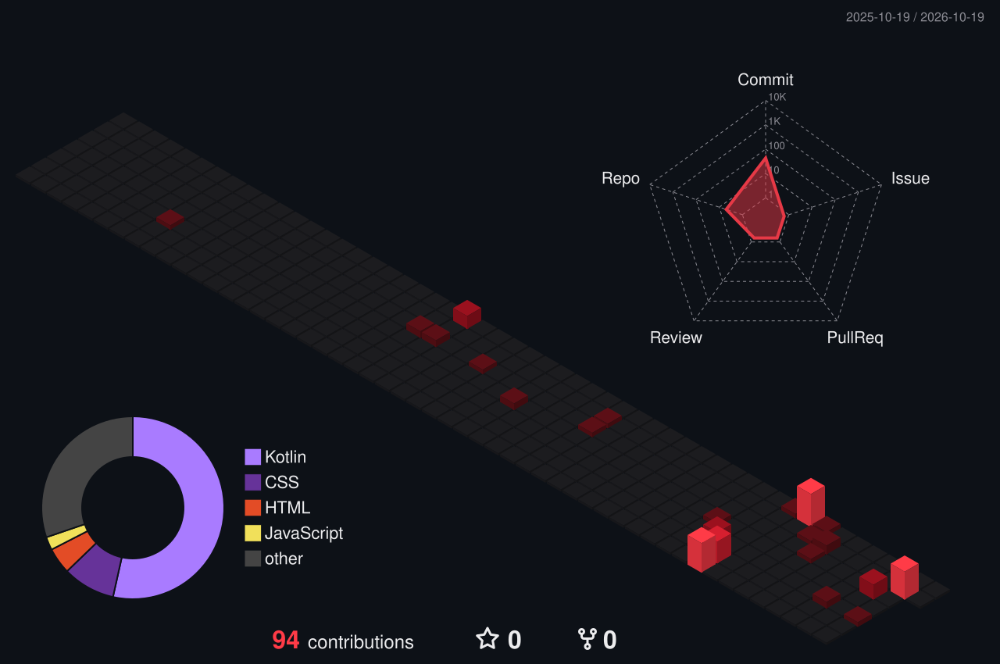
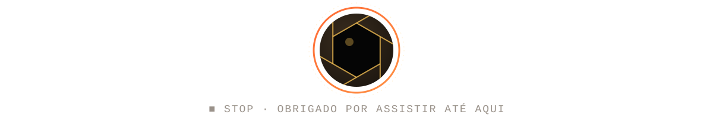

<!--
  README DE PERFIL — Victor Rossi
  Conceito: o perfil é o visor de uma câmera; cada seção é um "frame".
  Arquivos locais (pasta assets/): banner.svg, typing.svg, divider.svg,
  shutter.svg e visuall-logo.png — todas as animações são SVG do próprio repo.
-->

  

  

  
  
  

### `[ FRAME 01 ]` &nbsp;sobre mim

| | |
|---|---|
| 🎓 **Graduação** | Engenharia de Software na **FIAP** |
| 🔧 **Formação técnica** | Técnico em **Mecatrônica** pela ETEC Prof. Horácio Augusto da Silveira (**HAS**) |
| 🎂 **Idade** | 19 anos |
| 🎯 **Foco** | Python · Visão Computacional · Design |

### `[ FRAME 02 ]` &nbsp;projetos

<b>🤟 VisuAll</b> — tradução de Libras em tempo real &nbsp;<code>confiança: 0.99</code>

 

Aplicativo que reconhece Libras pela câmera e traduz em tempo real, permitindo que
pessoas ouvintes se comuniquem com pessoas surdas. Funciona no celular e também em
**óculos com câmera ESP32**, deixando a conversa com as mãos livres. Desenvolvido em
equipe no **Challenge FIAP 2026**, em parceria com a **JOVI**.

 

**Minhas responsabilidades**

- 🔤 **Modo Alfabeto** — funcionamento do reconhecimento das letras de Libras
- 📱 **App Android** — desenvolvimento do aplicativo em Kotlin
- 🎨 **Design do app** — interface, paleta de cores e experiência de uso
- 👓 **Óculos** — construção da parte física do protótipo com câmera ESP32
- 📊 **Apresentações** — criação de todos os slides das bancas do Challenge

`Python` `MediaPipe` `Kotlin` `Android Studio` `ESP32` `WebSocket` `Figma` `Canva` `CapCut`

[**abrir repositório ↗**](https://github.com/Juanduarte050508/VisuAll)

<b>🦾 Robotic Hand</b> — mão robótica controlada por visão computacional &nbsp;<code>confiança: 0.97</code>

 

Projeto final do curso técnico em Mecatrônica. Uma webcam captura os pontos de
referência da mão em tempo real, e um Arduino reproduz os movimentos em 5 servomotores.
Foi o ponto de partida para o VisuAll.

`Python` `OpenCV` `MediaPipe` `Arduino C++`

[**abrir repositório ↗**](https://github.com/Juanduarte050508/Engineering-Portfolio)

### `[ FRAME 03 ]` &nbsp;tecnologias

**Linguagens** 

**Visão Computacional** 

**Mobile e Front-end** 

**Hardware** 

**Ferramentas** 

**Design e Mídia** 

### `[ FRAME 04 ]` &nbsp;atividade

  

### `[ FRAME 05 ]` &nbsp;próximos passos

- 💼 Conquistar meu primeiro **estágio** em desenvolvimento de software
- 🎬 Lançar um **canal no YouTube** sobre programação, compartilhando projetos e o que aprendo pelo caminho

 

  

